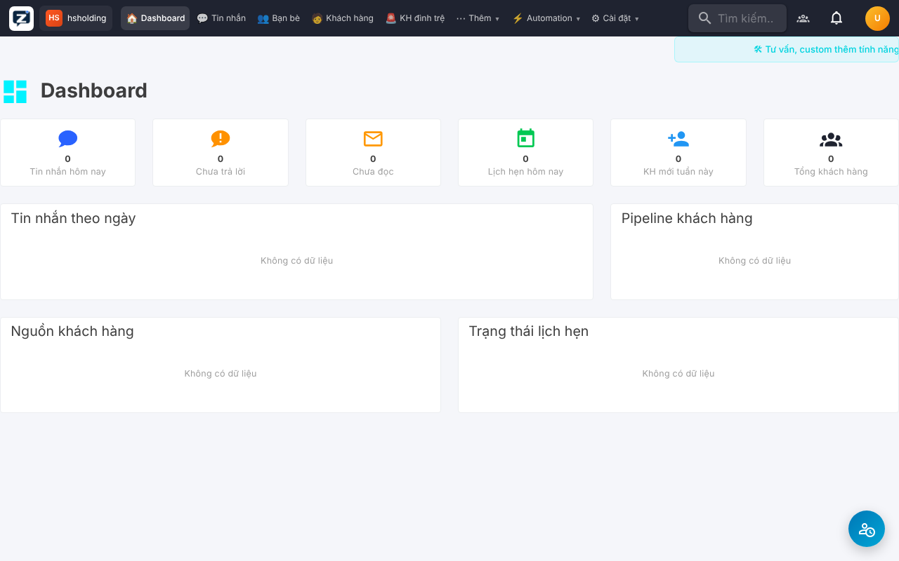

# ZL-CRM — Cài & mở bằng 1 cú bấm

Bộ script tự cài [ZL-CRM](https://github.com/nguyentatkiem/ZL-CRM) trên máy cá nhân và mở giao diện tại **http://localhost:3080**.

## Yêu cầu (cài 1 lần)
- **Docker Desktop**: https://www.docker.com/products/docker-desktop/ (cài xong mở lên 1 lần).
- Khoảng 5 GB ổ cứng trống, RAM ≥ 4 GB.

## Cách dùng
| Hệ điều hành | Mở CRM | Tắt CRM |
|---|---|---|
| Windows | Bấm đúp `MO-ZL-CRM.bat` | `TAT-ZL-CRM.bat` |
| macOS / Linux | `./mo-zl-crm.sh` | `./tat-zl-crm.sh` |

Lần đầu mất 5–10 phút (tải mã nguồn, build, tạo database). Các lần sau chỉ vài giây.
Script tự: tải mã nguồn → tạo file `.env` với mật khẩu ngẫu nhiên → chạy Docker → tạo tài khoản quản trị → mở trình duyệt.

> Ghi chú: MinIO đã gỡ image `minio/minio` khỏi Docker Hub, nên `docker-compose.override.yml` thay bằng bản tương thích `pgsty/minio` — nếu không có file này thì cài theo hướng dẫn gốc sẽ lỗi.

## Tài khoản quản trị mặc định
- **Email:** `admin@zlcrm.local` (hoặc số điện thoại `0900000000`)
- **Mật khẩu:** `Admin@123456`

➡️ Đăng nhập xong hãy **đổi mật khẩu** ngay. (Muốn đổi email/mật khẩu mặc định trước khi chạy lần đầu: sửa đầu file `mo-zl-crm.ps1` hoặc `mo-zl-crm.sh`.)

Dữ liệu được giữ trong Docker volume, tắt/mở lại không mất.

